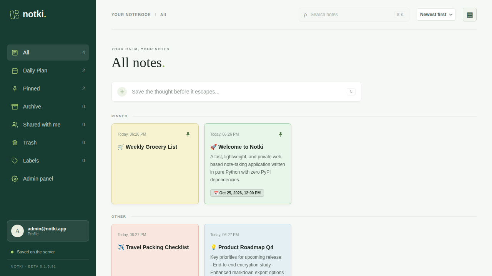
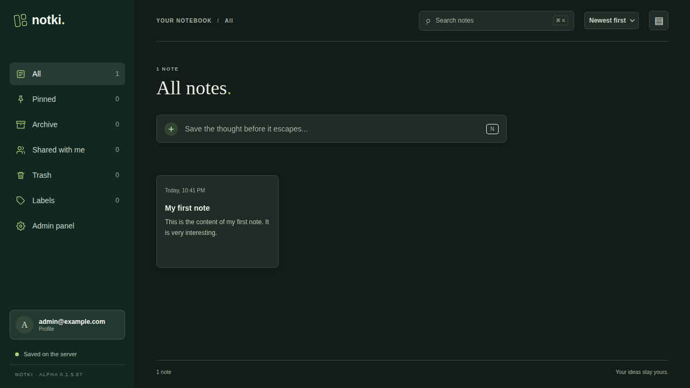
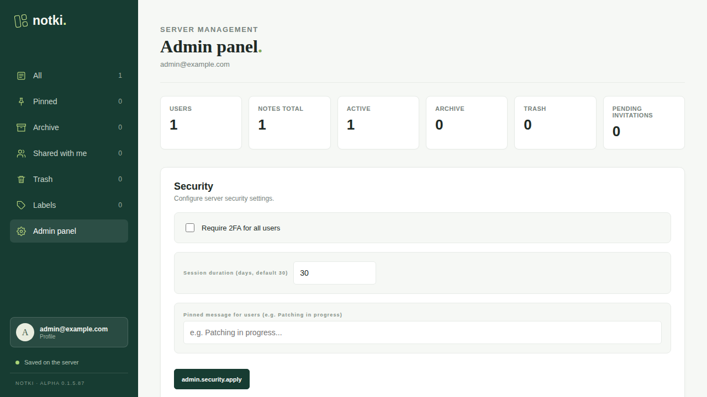
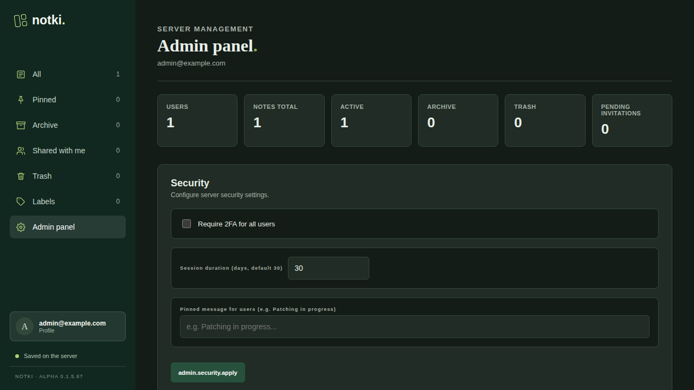
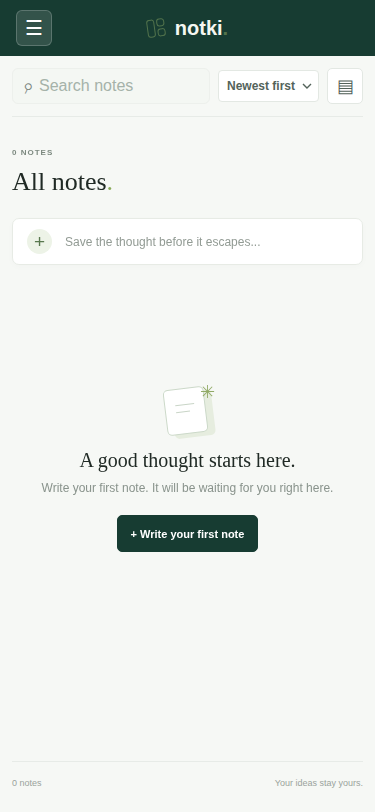

# Notki

**Private notes. Your server. No telemetry.**

`v0.1.6.12` | `python 3.9+` | `sqlite` | `mit`

Notki is a small, self-hosted notebook for people who want their notes to stay on their own machine. It combines a fast browser UI with a single-file SQLite database, optional note sharing, passkeys and TOTP, and password-encrypted backups.

No external database. No third-party cloud. No analytics.

**Stack:** Python 3.9+ | SQLite | Vanilla JS | WebAuthn | Cryptography

---

## Features

- **Notes:** Rich text, checklists with progress, drag-and-drop tasks, note colors, pinning, archive, and trash.
- **Planning:** Due dates, a daily plan grouped by urgency, and iCalendar (.ics) export.
- **Organization:** Custom labels, search, flexible sorting, and a quick-note capture row.
- **Sharing:** Share notes with other users on the same server as read-only or read-write.
- **Offline:** Browser caching and automatic sync when the connection returns.
- **Accounts:** Profiles, avatars, password changes, and per-user labels.
- **Authentication:** TOTP apps, WebAuthn passkeys / hardware keys, recovery codes, optional server-wide 2FA enforcement, and fail2ban.
- **Backups:** Mandatory AES-256-GCM `.enc` backups, authenticated metadata, full validation, atomic restore, and a CLI path for large archives.
- **Administration:** User management, single-use invitations, server stats, announcements, and update checks.
- **Interface:** Light, dark, and system themes; English, Polish, German, French, Japanese, Korean, Italian, and Spanish.

---

## Screenshots

Captured from a demo instance running the current code.

### Desktop

<p align="center">
  
  
</p>

<p align="center">
  
  
</p>

### Mobile

<p align="center">
  
  
  
  
</p>

---

## Quickstart

**Docker Compose (recommended)**

```bash
mkdir notki && cd notki
curl -sO https://raw.githubusercontent.com/shirou93/Notki/main/update.sh
bash update.sh
docker compose logs notki | grep "SETUP TOKEN"
```

Output:
```text
SETUP TOKEN: <generated on first run>
```

Open `http://localhost:8000/setup`.

Paste the token into the setup page and create the administrator account. The setup API always requires the one-time token; there is no localhost bypass.

To choose your own token, set `NOTKI_SETUP_TOKEN` in `.env` before the first start. To publish a different host port, set `NOTKI_HTTP_PORT` in `.env`. Keep the token out of shell history and logs.

---

## Backups

Create and restore backups from **Admin panel -> Server-wide backups**. Every backup is a single `.enc` file protected by a password you choose.

The archive contains accounts, notes, labels, invitations, note shares, passkeys (public keys only), TOTP secrets, MFA recovery codes, and server settings. Active sessions are never included. Restoring a backup signs every user out.

### Security Properties:

- Always encrypted. There is no plaintext export path.
- AES-256-GCM with a unique 96-bit nonce for every backup.
- scrypt key derivation with n=65536, r=8, p=1, a random 16-byte salt, and a 32-byte key.
- The JSON header (format, version, creation time, KDF, and cipher parameters) is authenticated as AES-GCM additional data. Tampering is detected.
- The backup password is the only decryption key. Notki does not store it and has no server-side key fallback.
- Fail closed. If a stored TOTP secret cannot be decrypted, backup creation aborts instead of silently dropping MFA data.
- Restores are validated in full and applied inside one transaction. A failed restore changes no data.

### Restore from the CLI (Large Backups)

The web upload limit is 140 MB, and the decrypted snapshot is capped at 100 MB. For larger archives, stop Notki and restore the file locally on the server host:

```bash
python3 server.py --restore-backup /path/to/notki-backup-YYYYMMDD-HHMMSSZ-xxxx.enc
```

The password prompt is hidden, and the command requires typing `RESTORE` to confirm that all existing data will be replaced. For automation, provide the password through a protected file and skip the prompt:

```bash
python3 server.py \
  --restore-backup /path/to/notki-backup-YYYYMMDD-HHMMSSZ-xxxx.enc \
  --backup-password-file /run/secrets/notki-backup-password \
  --yes
```

You can also set `NOTKI_BACKUP_PASSWORD` in the environment. An explicit `--backup-password-file` takes precedence. Never pass the password as a command-line argument, because process listings may expose it.

The CLI uses the same authenticated decryption, KDF bounds, snapshot validation, and transaction as the web endpoint. Its default file limit is 2048 MiB and can be changed with `--max-backup-size-mb` up to 16384 MiB. The archive is read and decrypted in memory, so the host needs enough RAM for the file plus its decoded JSON.

*Backups are not a substitute for TLS. Store the password separately from the backup, keep backups on protected storage, and test a restore on a staging instance periodically.*

Full details, API examples, and migration notes: `docs/backup.md`

---

## Administration CLI

Run administrative commands locally on the host. For a restore, stop the server first so only one process touches the SQLite database.

- `python3 server.py --create-admin` : Create the initial administrator account.
- `python3 server.py --disable-2fa user@example.com` : Disable 2FA for one user by e-mail or user ID.
- `python3 server.py --disable-all-2fa` : Disable 2FA for every user on the server.
- `python3 server.py --unban 192.168.1.100` : Remove one IP address from the fail2ban list.
- `python3 server.py --unban-all` : Remove every fail2ban ban.
- `python3 server.py --host 0.0.0.0 --port 8000` : Override the bind address and port.
- `python3 server.py --restore-backup FILE` : Restore an encrypted backup offline and exit.

---

## Configuration

Environment variables:

- **NOTKI_HOST**: Bind address (default: `127.0.0.1`, `0.0.0.0` in Docker)
- **NOTKI_PORT**: HTTP port (default: `8000`)
- **NOTKI_DB_PATH**: SQLite database path (default: `./data/notki.sqlite3`)
- **NOTKI_BACKUP_DIR**: Directory for encrypted `.enc` backups (default: `./data/backups`)
- **NOTKI_SETUP_TOKEN**: One-time token required by setup and import APIs (default: Generated and printed)
- **NOTKI_TRUST_PROXY**: Proxy peers whose forwarding headers are trusted (`1`, `true`, `all`, or an IP/CIDR list) (default: Loopback only)
- **NOTKI_ALLOWED_HOSTS**: Optional hostname allowlist for forwarded hosts (default: Empty)
- **NOTKI_PUBLIC_HOST**: Canonical public host or full URL used for links and Origin checks (default: Empty)
- **NOTKI_COOKIE_SECURE**: Force Secure + `__Host-` session cookies (`1`) or detect automatically (default: Automatic)
- **NOTKI_PUBLIC_HTTPS**: Emit HTTPS links when TLS terminates at a proxy (default: `0`)
- **NOTKI_BACKUP_PASSWORD**: Backup password for CLI restore only; never put it in argv (default: Empty)

### Reverse Proxy and HTTPS

Notki validates the `Origin` and `Referer` scheme, host, and port on every mutating request. `X-Forwarded-*` headers are only accepted from peers allowed by `NOTKI_TRUST_PROXY`.

- Set `NOTKI_PUBLIC_HOST` to the canonical public URL.
- Configure the proxy to overwrite forwarding headers rather than append untrusted values.
- Trust only your proxy's address or CIDR range.
- Keep the setup page off the public internet until the administrator exists.

---

## Security Notes

- First-run setup requires the setup token for every setup and import API call.
- Mutating requests reject cross-origin attempts by default.
- TOTP secrets are encrypted at rest. A stored but undecryptable secret still requires a second factor; password-only login remains blocked.
- Passkey private keys never leave the client. Backups contain only public keys, names, and signature counters.
- Backup metadata is authenticated, and plaintext or legacy backup paths do not exist.
- Restoring a backup is a destructive administrative operation. It replaces all data and invalidates sessions.
- Use HTTPS in production, protect the setup token, and keep backup passwords outside the backup directory.
- Run one Notki process per SQLite database. The backup/restore lock is process-local.

---

## Development

```bash
python3 -m pip install --only-binary=:all: -r requirements.txt
python3 -m unittest discover -s tests -v
python3 -m py_compile server.py
```

Runtime dependencies are pinned in `requirements.txt` (`webauthn` for passkeys and `cryptography` for encrypted backups).

The suite includes security-focused backup tests for wrong passwords, tampered ciphertext and metadata, malformed snapshots, oversized input, path traversal, and undecryptable MFA secrets.

---

## License

MIT. See [LICENSE](LICENSE).
