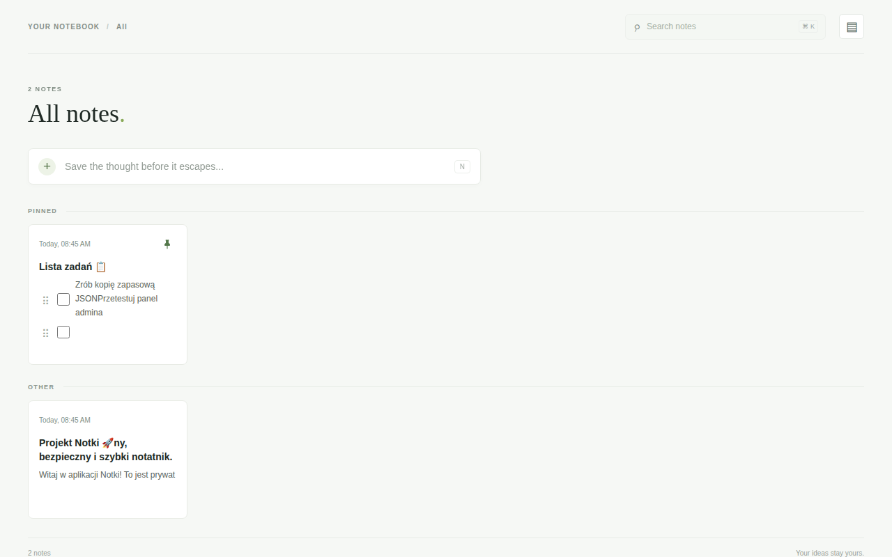
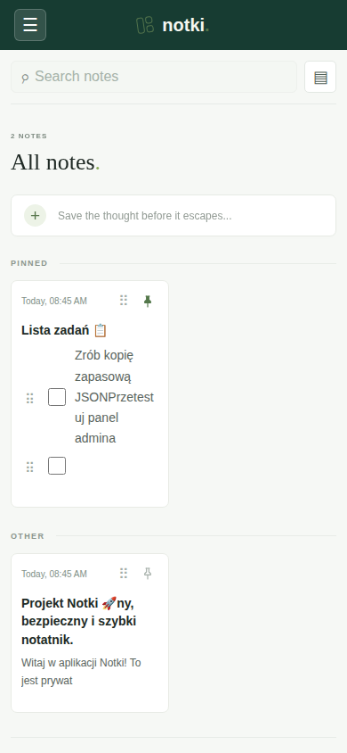
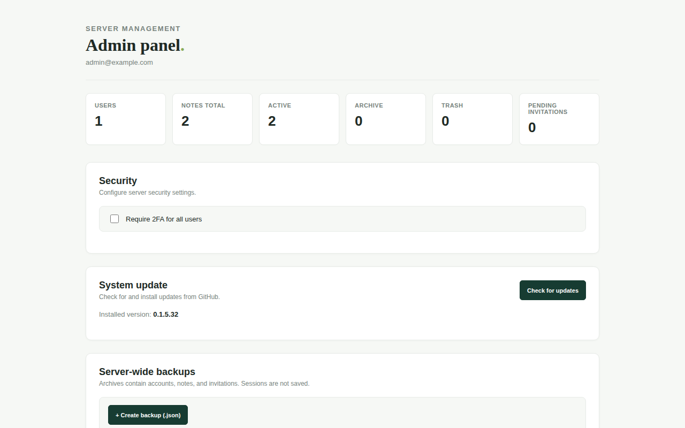
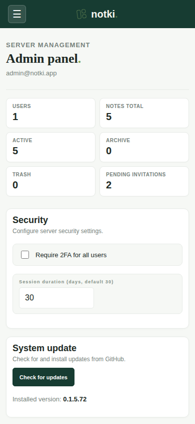

# Notki

A fast, lightweight, and private web-based note-taking application written in pure Python (Python 3.9+) with zero external dependencies from PyPI.



---

## 🚀 Key Features

- 📝 **Note Creation & Editing**: Rich text formatting (bold, italic, underline), bulleted and numbered lists, plus interactive checklists with progress bars and drag-and-drop handles.
- 🏷️ **Labels & Organization**: Flexible tagging system, pin essential notes, archive inactive items, send unwanted notes to trash, and personalize cards with distinct background colors.
- 🤝 **Note Sharing**: Securely share notes with other users on your server with read-only or read-write permissions.
- 📶 **Offline Support & Sync**: Work seamlessly offline thanks to browser `localStorage` caching and automated background synchronization when connectivity is restored.
- 👤 **User Profiles & Avatars**: Personalize user accounts and upload custom avatars.
- 🔐 **Advanced Security**:
  - Two-Factor Authentication (2FA) via TOTP authenticator apps and WebAuthn Passkeys / hardware security keys.
  - Sliding-window rate limiting on login endpoints to prevent brute-force attacks.
  - Enforce 2FA server-wide via administrative settings.
- 💾 **JSON Backups**: Create, download, restore, and import complete server backups in transparent `.json` format.
- ⚙️ **Admin Panel**: Manage user accounts, create invitation links with customizable expiration periods (in days), monitor server statistics, and perform automated updates directly from GitHub.
- 🎨 **Themes & Multi-Language (i18n)**: Native Light, Dark, and System themes, with built-in support for multiple languages (English, Polish, German, French, Japanese, Korean, Italian, Spanish).

---

## 📱 Screenshots

| View | Desktop | Mobile |
|---|---|---|
| **Notes** |  |  |
| **Admin Panel** |  |  |

---

## 🛠️ Recommended Installation (Docker Compose)

The easiest and recommended way to deploy Notki is using **Docker Compose**.

1. Create a project directory and download `docker-compose.yml`:
   ```bash
   mkdir notki && cd notki
   curl -O https://raw.githubusercontent.com/shirou93/Notki/main/docker-compose.yml
   ```

2. Start the container in background mode:
   ```bash
   docker compose up -d
   ```

3. Open your browser at `http://localhost:8000/setup` and complete the initial administrator setup.

---

## 💻 Alternative Installation Methods

### 1. Direct Execution (Python 3.9+)

Notki relies strictly on the Python standard library and requires no `pip` packages.

```bash
git clone https://github.com/shirou93/Notki.git
cd Notki
python3 server.py
```
The application will be accessible at `http://localhost:8000`.

### 2. Native Linux Installation (Systemd)

On Linux distributions (Debian, Ubuntu, Arch, Fedora, Alpine, etc.), you can run the automated installer script:

```bash
sudo ./install.sh
```
The script creates a dedicated system user `notki`, installs the application into `/opt/notki`, and configures a systemd service.

---

## 🛡️ Server Backups (JSON Backup)

From the **Admin Panel** under **Server Backups**, you can easily manage server data:
- Backups include all user accounts, notes, labels, invitations, and system settings.
- Files are saved in human-readable `.json` format with timestamped filenames (e.g., `notki-backup-20261014-120000Z-a1b2c3d4.json`).
- You can download backups, restore existing archives on the server, upload `.json` backups from your local device, or import a backup during initial first-run setup on a new server.

---

## ⚙️ Environment Variables

| Variable | Description | Default Value |
|---|---|---|
| `NOTKI_HOST` | Network interface IP for server binding | `127.0.0.1` (`0.0.0.0` in Docker) |
| `NOTKI_PORT` / `NOTKI_HTTP_PORT` | HTTP server port | `8000` |
| `NOTKI_DB_PATH` | Path to the SQLite3 database file | `./data/notki.sqlite3` |
| `NOTKI_BACKUP_DIR` | Directory path for storing JSON backups | `./data/backups` |
| `NOTKI_ALLOW_REMOTE_SETUP` | Allow first-time setup from remote IP addresses | `0` (`1` in Docker) |

> **Reverse Proxies & HTTPS (Cloudflare Tunnel, Nginx, Caddy, Traefik, NPM):**
> Notki operates natively as an HTTP server and automatically detects reverse proxy forwarding headers (`X-Forwarded-Proto`, `X-Forwarded-Host`, `X-Forwarded-Ssl`). It handles secure cookie flags and generates valid HTTPS invite links without extra SSL configuration inside the app.

---

## 📜 License

This open-source project is distributed under the terms of the MIT License.
